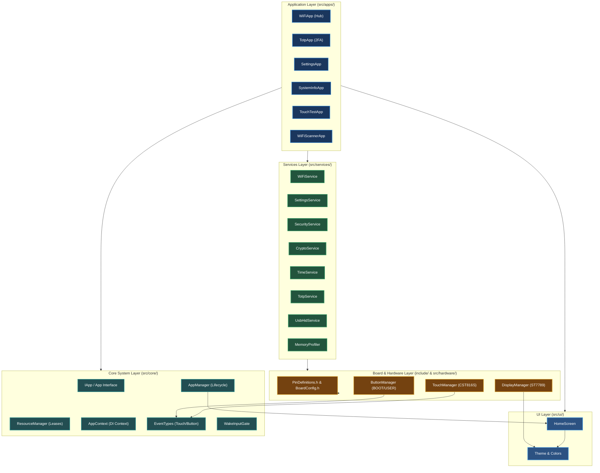
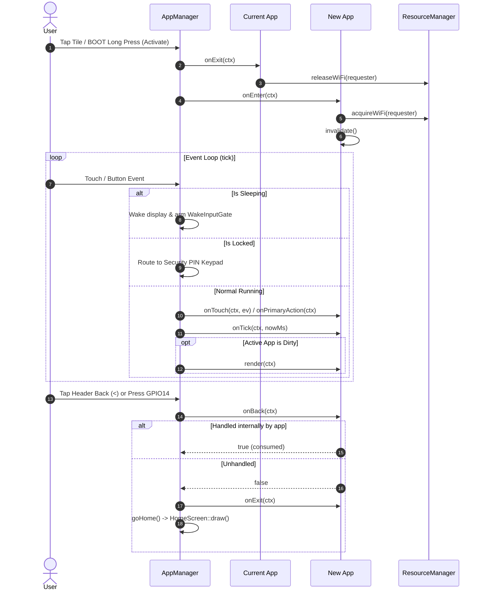

# Architecture — NibruOS

NibruOS is an in-process ESP32-S3 firmware platform and Windows desktop simulation suite structured as a **Feature-Based Modular Monolith with Layered Responsibilities and Hardware Abstraction (HAL)**.

See [ADR-0002](decisions/0002-modular-architecture.md) for architectural decisions, [Desktop Simulator](DESKTOP_SIMULATOR.md) for cross-platform engine details, and [Engineering Workflow](ENGINEERING_WORKFLOW.md) for lifecycle standards.

## 1. System Layering Overview

## 2. Layer Responsibilities

### 2.1 Core System Layer (`src/core/`)
- **Lifecycle Coordination**: `AppManager` maintains active application state, performs clean entry/exit transitions, and handles hardware button/touch routing.
- **Application Interface**: `IApp.h` and `App.h` define the standardized virtual lifecycle contract (`onEnter`, `onExit`, `onTick`, `onTouch`, `onPrimaryAction`, `onActivate`, `onBack`, `render`, `onDisplayRestored`).
- **Normalized Event System**: `EventTypes.h` defines `TouchEvent`, `TouchGesture`, and `ButtonAction`. Core abstractions do not include hardware driver headers.
- **Resource Lease Ownership**: `ResourceManager` governs mutual exclusion for radios (e.g. `ResourceOwner::WiFiScanner`) ensuring no concurrent driver conflicts.
- **Context Injection**: `AppContext` passes references to shared singletons (`display`, `resources`, `wifi`, `security`, `settings`, `time`, `totp`, `usbHid`), eliminating hidden global state.
- **Wake Suppression**: `WakeInputGate` filters accidental contact or hold gestures during sleep wake-up.

### 2.2 Reusable UI Layer (`src/ui/`)
- **Home Screen Presentation**: `HomeScreen` encapsulates 2-card and 3-card paginated layout, tile badges, card clipping, and text formatting. `AppManager` delegates home rendering directly to `HomeScreen::draw`.
- **Theme & Colors**: `Theme.h` provides RGB565 color palettes (`Colors::*`), standard layout metrics (`HeaderHeight = 33`, `FooterHeight = 18`), and accent lookup for Settings themes.

### 2.3 Services Layer (`src/services/`)
- **Wi-Fi Subsystem**: `WiFiService` owns Station mode, connection state machine, saved networks persistence in NVS, and encapsulated MAC address retrieval.
- **Persistent Preferences**: `SettingsService` provides atomic 5-byte versioned NVS storage for brightness, sleep timeout, and theme accent.
- **Security & Cryptography**: `SecurityService` enforces PBKDF2 PIN verification, ephemeral SRAM session keys, and anti-brute-force lockouts. `CryptoService` provides mbedTLS hardware acceleration (AES-256-GCM, HMAC, TRNG).
- **Authentication & Input**: `TotpService` computes RFC 6238 tokens and manages encrypted vaults. `UsbHidService` emulates an ESP32-S3 USB keyboard for keystroke injection.
- **Time Synchronization**: `TimeService` provides non-blocking NTP synchronization and calendar formatting.
- **Diagnostics & Governance**: `MemoryProfiler` tracks internal SRAM, PSRAM, FreeRTOS stack high-water marks, and loop latency without dynamic memory allocation.

### 2.4 Board & Hardware Layer (`include/` and `src/hardware/`)
- **Centralized Pin Configuration**: `PinDefinitions.h` centralizes all physical GPIO pins for the LILYGO T-Display-S3 Touch Glass (ST7789 parallel bus, CST816S touch, BOOT/USER buttons, and proposed unverified MicroSD SPI pins). `BoardConfig.h` preserves validated timing and constants.
- **Display Driver**: `DisplayManager` owns ST7789 initialization, GPIO15 power control, and GPIO38 AW9364 pulse dimming (or optional LEDC PWM).
- **Touch Driver**: `TouchManager` initializes CST816S via I2C, performs landscape coordinate transform (`x=rawY`, `y=169-rawX`), latches contact identities, and suppresses duplicate release events.
- **Button Driver**: `ButtonManager` performs transition-only debouncing and long-press classification for BOOT (GPIO0) and USER (GPIO14).

### 2.5 Application Layer (`src/apps/`)
- **Independent Feature Ownership**: Each application owns its screen state, local buffers, and navigation hierarchy.
- **Hub Architecture**: Complex features use subview delegation (e.g. `WiFiApp` embeds `WiFiScannerApp`; `SettingsApp` embeds `TouchTestApp`).
- **Resource Discipline**: Every application releases acquired resource leases and cancels active jobs in `onExit()`.

## 3. Application Lifecycle Sequence

## 4. Execution Targets & Shared Code Policy

NibruOS supports two targets compiled from shared application code:
1. **Embedded Target (`lilygo-t-display-s3`)**: Real ESP32-S3R8 hardware running Arduino-ESP32, TFT_eSPI, CST816S, and native FreeRTOS.
2. **Desktop Simulator Target (`nibru_simulator`)**: Windows desktop executable using SDL2, RGB565 framebuffer simulation, and simulated peripherals (`MockWiFiService`, `DesktopStorage`, `DesktopInput`).

Applications and UI logic reside in platform-neutral code in `src/` and must never include target-specific headers (`SDL.h` or hardware registers) directly.
