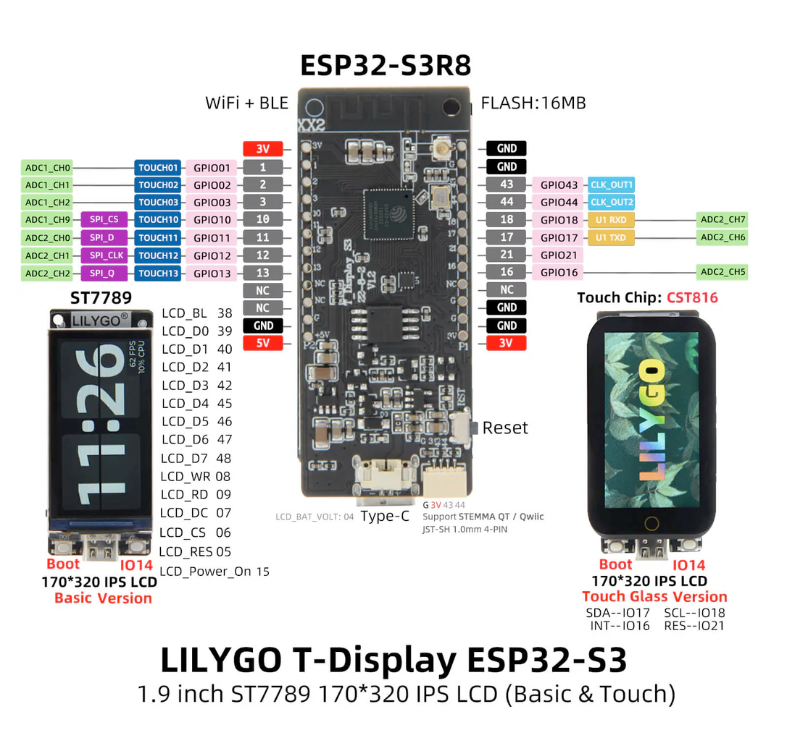

# Exact hardware pinout — LILYGO T-Display-S3 Touch Glass

**Applicability**: owner's 1.9" IPS ST7789V LCD + CST816S **Touch Glass** variant, ESP32-S3R8 with 16 MB Flash + 8 MB PSRAM. **Not** T-Display-S3 AMOLED, and do not automatically apply to regular Basic variant. ESP32 native logic is **3.3 V**; do not connect 5 V to GPIOs.



## Exact known-good touch and input setup
| Function | GPIO | Usage | Evidence |
|---|---:|---|---|
| Touch SDA | **18** | CST816S I2C data | user-tested sketch AND LilyGO official README |
| Touch SCL | **17** | CST816S I2C clock | user-tested sketch AND LilyGO official README |
| Touch Reset | **21** | output reset pulse | user-tested sketch |
| Touch INT | **16** | input pull-up, FALLING | user-tested sketch |
| BOOT | **0** | active LOW button; bootstrapping-sensitive | owner sketch + LilyGO docs |
| User key | **14** | active LOW button; app Back | owner sketch + LilyGO docs |

Exact tested sketch fragment:

```cpp
#define TOUCH_SDA 18
#define TOUCH_SCL 17
#define TOUCH_RST 21
#define TOUCH_INT 16
CST816S touch(TOUCH_SDA, TOUCH_SCL, TOUCH_RST, TOUCH_INT);
pinMode(TOUCH_INT, INPUT_PULLUP);
pinMode(TOUCH_RST, OUTPUT);
digitalWrite(TOUCH_RST, LOW); delay(10);
digitalWrite(TOUCH_RST, HIGH); delay(50);
touch.begin(FALLING);
tft.init(); tft.setRotation(1); // 320x170
// x = rawY; y = 169 - rawX
```

**Important inconsistency:** bottom caption of the owner-supplied pinout IMAGE says `SDA=IO17, SCL=IO18`; official LilyGO GitHub README explicitly says `IIC SDA 18`, `IIC SCL 17`, and user's successful code uses 18/17. **Do NOT swap these two wires based on image caption.** Shared I2C header can host compatible additional I2C devices only with care to pullups, address conflicts, bus voltage and interrupt/reset ownership.

## TFT ST7789V — eight-bit parallel bus; reserved, never reassign
| Signal | GPIO | Signal | GPIO |
|---|---:|---|---:|
| LCD Power Enable | **15** | LCD Backlight | **38** |
| LCD RESET | **5** | LCD Chip Select | **6** |
| LCD Data/Command (DC) | **7** | LCD WR | **8** |
| LCD RD | **9** | LCD D0 | **39** |
| LCD D1 | **40** | LCD D2 | **41** |
| LCD D3 | **42** | LCD D4 | **45** |
| LCD D5 | **46** | LCD D6 | **47** |
| LCD D7 | **48** | | |

`pinMode(15, OUTPUT); digitalWrite(15,HIGH); pinMode(38,OUTPUT); digitalWrite(38,HIGH);` must precede `tft.init()`. `platformio.ini` owns TFT_eSPI defines, no hand-edit of vendor library `User_Setup.h`. GPIO45 and GPIO46 are also ESP32-S3 strapping-sensitive — reserved by LCD on this board.

## Other integrated facilities
| Item | GPIO(s) | Notes |
|---|---|---|
| Battery voltage measurement | **4** | ADC reading via board divider; calibration REQUIRED; LilyGO warns voltage reading may not work with USB-C connected. |
| USB-C native USB | **19, 20** on ESP32-S3 USB PHY | Dedicated USB D−/D+ lines; don't allocate to sensors. USB HID needs careful explicit user activation. |
| UART | **43 TX, 44 RX** | Exposed on edge and Qwiic pin labeling; avoid clash with logging/programming; not general-purpose by default if UART needed. |
| STEMMA QT/Qwiic 4-pin | **GPIO43, GPIO44, 3V3, GND** according to *owner pinout image* small connector text | **Verify actual connector PCB pin labels/schematic before attaching devices.** LilyGO also lists I2C separately on 18/17; the small labeled connector may be used as an alternate UART-type expansion and must not be treated as I2C without electrical verification. |
| U.FL / IPEX footprint | board RF connector | Owner has external antenna+pigtail. Confirm antenna selection population/pin routing and correct antenna system before diagnosing range. |
| Reset button | reset circuit | Not an application GPIO. |
| SD shield add-on option | 13 (CMD), 11 (CLK), 12 (D0) | Pins are **not** proof of on-board SD slot; require separate shield; avoid conflicts if mounted. |

## Exposed pins (according to owner's photo, viewed from **rear** with USB at bottom)
| Left pad from top | Signal | Default reservation |
|---|---|---|
| 1 | 3.3V | regulated power, not GPIO |
| 2 | GPIO1 | candidate GPIO / ADC1_CH0 |
| 3 | GPIO2 | candidate GPIO / ADC1_CH1 |
| 4 | GPIO3 | candidate GPIO, **strapping** pin — special care at boot |
| 5 | GPIO10 | candidate GPIO, ADC1_CH9 / expansion SPI CS |
| 6 | GPIO11 | candidate GPIO, expansion SD/SPI function |
| 7 | GPIO12 | candidate GPIO, expansion SD/SPI function |
| 8 | GPIO13 | candidate GPIO, expansion SD/SPI function |
| 9 | NC | NOT CONNECTED |
| 10 | NC | NOT CONNECTED |
| 11 | GND | ground |
| 12 | 5V | power rail — NOT GPIO, voltage/power path verify |

| Right pad from top | Signal | Default reservation |
|---|---|---|
| 1 | GND | ground |
| 2 | GND | ground |
| 3 | GPIO43 | UART TX, possible connector share |
| 4 | GPIO44 | UART RX, possible connector share |
| 5 | GPIO18 | **touch/I2C SDA** |
| 6 | GPIO17 | **touch/I2C SCL** |
| 7 | GPIO21 | **touch reset** |
| 8 | GPIO16 | **touch interrupt** |
| 9 | NC | NOT CONNECTED |
| 10 | NC | NOT CONNECTED |
| 11 | GND | ground |
| 12 | 3.3V | regulated power, not GPIO |

The numbered contact order is **specific to the image as seen from the back**. Reversing the board flips the visual left/right; always use printed PCB GPIO labels, not only pin index.

## GPIO allocation policy
- **Already reserved**: TFT 5,6,7,8,9,15,38,39–42,45–48; touch 16,17,18,21; buttons 0,14; battery sense 4; native USB 19,20.
- **Generally available candidates**: 1,2,10,11,12,13, subject to peripheral/power/ADC/SD-shield constraints. GPIO3 is bootstrapping-sensitive; use with care. GPIO43/44 are UART/connector shared; use only after checking active UART use.
- **Do not assert** arbitrary GPIO is safe simply because it appears in the chip datasheet. Onboard board wiring and boot straps override chip capabilities. Not every ADC channel remains accurate when Wi-Fi is active, especially ADC2; prioritize ADC1 for analog sensors, and characterize actual behavior.
- Any new wiring must include the accessory's **voltage, logic levels, pull-ups, power budget, GND, frequency/interface, mechanical securing**, ESD considerations, and whether connections are on exposed headers or require soldering.

## Battery / power safety
This board can be powered over USB-C or appropriate battery/power input only per the PCB power circuit specification. Never connect a raw Li-ion cell directly to 3V3 or 5V; use a correct protected cell and compatible charger/connector after checking board pinout and polarity. The diagram does **not** prove a battery charger configuration for every hardware revision. Confirm schematic and connector pins before wiring any battery. Measure external accessory current consumption; ESP32-S3 Wi-Fi spikes can reset weak supplies.

## Sources / caveats
- User's provided `pinout-1086.png` (embedded above) + owner-tested original sketch (hardware settings).
- Manufacturer: https://github.com/Xinyuan-LilyGO/T-Display-S3
- Manufacturer wiki: https://wiki.lilygo.cc/products/t-display-series/t-display-s3/
- The small expansion connector labeling and RF antenna selection should be confirmed electrically/revision-specifically. The pictured module shows a U.FL connector, but doesn't guarantee correct populated RF switch selection on your particular board.
